# S2.03 - Network Services Installation: Technical Wiki

> **Course:** S2.03 - Installation de services réseaux
> **Instructor:** Bouter - bouter.serge@u-bordeaux.fr
> **University of Bordeaux - IUT Informatique**
> **Authors:** See [Team Members](#1-team-members)

---

## Table of Contents

- [1. Team Members](#1-team-members)
- [2. Context and Software Overview](#2-context-and-software-overview)
  - [2.1 NEmu - Virtual Network Emulator](#21-nemu--virtual-network-emulator)
  - [2.2 Nextcloud](#22-nextcloud)
  - [2.3 OnlyOffice](#23-onlyoffice)
  - [2.4 Snap Package Manager](#24-snap-package-manager)
  - [2.5 Plugins Overview](#25-nextcloud-plugins-overview)
  - [2.6 Key Commands Reference](#26-key-commands-reference)
- [3. Network Architecture](#3-network-architecture)
  - [3.1 Topology](#31-topology)
  - [3.2 IP Addressing Plan](#32-ip-addressing-plan)
- [4. Getting Started with NEmu](#4-getting-started-with-nemu)
- [5. System and Network Configuration](#5-system-and-network-configuration)
  - [5.1 User Management](#51-user-management)
  - [5.2 Dynamic Network Configuration](#52-dynamic-network-configuration)
  - [5.3 Static Network Configuration](#53-static-network-configuration)
- [6. Server Installation and Configuration](#6-server-installation-and-configuration)
  - [6.1 Nextcloud Installation](#61-nextcloud-installation)
  - [6.2 Nextcloud Security Configuration](#62-nextcloud-security-configuration)
  - [6.3 Nextcloud General Configuration](#63-nextcloud-general-configuration)
  - [6.4 OnlyOffice Installation](#64-onlyoffice-installation)
  - [6.5 Nextcloud Plugins](#65-nextcloud-plugins)
- [7. Client Installation and Configuration](#7-client-installation-and-configuration)
- [8. Portfolio](#8-portfolio)

---

## 1. Team Members

| Name | Contact |
|------|---------|
| [Member 1 - Adrian STYZINSKI] | [adrian.styzinski@etu.u-bordeaux.fr] |
| [Member 2 - Simon Fousat FERET] | [simon.fousatferet@etu.u-bordeaux.fr] |
---

## 2. Context and Software Overview

### 2.1 NEmu - Virtual Network Emulator

[NEmu](https://gitlab.com/v-a/nemu) (Network Emulator) is an open-source virtual network environment built on top of QEMU. It allows multiple Linux virtual machines to be connected together in a configurable, realistic network topology. It emulates realistic networks of Debian machines using QEMU, and is controlled through an interactive Python console.

This project sets up a professional-grade private cloud infrastructure using a virtualized two-subnet network on Debian Linux. The goal is to deploy a file-sharing server (Nextcloud), a collaborative document editor (OnlyOffice), and connect them together with plugins. This is similar to a real-world enterprise network architecture.

Key facts for this project:

- Configuration name: `ncloud`
- Operating system on all VMs: `Debian Linux`
- Root password on all VMs: `plop`
- Sessions are saved to `~/vnet/ncloud.tgz`
- Source: https://gitlab.com/v-a/nemu

### 2.2 Nextcloud

[Nextcloud](https://nextcloud.com) is an open-source, self-hosted file synchronisation and collaboration platform. It provides functionality similar to Dropbox or Google Drive, but running entirely on your own infrastructure. Some of it's features include:

- File storage, versioning, and synchronisation
- User and group management with quota enforcement
- A full web interface accessible from any browser
- Manu plugin/app (calendar, contacts, document editor, password manager, etc.)
- A desktop client for automatic background synchronisation

In this project, Nextcloud is installed on the `ncloud` machine and acts as the main file server for the `alice` and `bob` clients.

### 2.3 OnlyOffice

[OnlyOffice](https://www.onlyoffice.com) (`onlyoffice-ds`) is an open-source web office suite. It allows users to create, edit, and collaborate on documents (text documents, spreadsheets, presentations) directly inside a browser, similar to Microsoft Office 365 or Google Docs. It integrates seamlessly with Nextcloud through a dedicated plugin.

In this project, OnlyOffice is installed on the separate `office` machine to offload document processing from the `ncloud` server. Just like in any professional environments.

### 2.4 Snap Package Manager

[Snap](https://snapcraft.io/) is a package manager developed by Canonical. Unlike `apt`, a Snap package bundles an application together with all its dependencies into a single file. The application runs inside a sandboxed environment, limiting its access to the host system and improving security.

| Feature | `apt` | `snap` |
|---------|-------|--------|
| Dependency handling | Shared system libraries | Bundled inside the package |
| Sandboxing | No | Yes |
| Auto-update | Manual | Automatic |
| Best for | Core system packages | Self-contained applications |

We use Snap to install both Nextcloud and OnlyOffice because both have numerous dependencies that would make a manual 'apt'-based installation more complex and error-prone.

### 2.5 Nextcloud Plugins Overview

| Plugin | Purpose |
|--------|---------|
| **ONLYOFFICE** | In-browser document editing (docx, xlsx, pptx, odt…) via the OnlyOffice server |
| **Splash** | Displays a background image (Wallhaven or Bing) on the Nextcloud login screen |
| **Passwords** | Full-featured password manager integrated into Nextcloud |
| **Secrets** | Share one-time encrypted secrets via a URL, no account required |
| **Draw.io** | Create and edit diagrams directly in the browser |
| **Calendar** | Shared group calendar for event management |
| **FormVox** | Create and share forms and surveys |
| **Notes** | Create and share notes (similar to notepad) |
| **Talk** | A quick messaging and calling platform |

### 2.6 Key Commands Reference

#### NEmu - from the host terminal

```bash
# Start the virtual network
/mnt/netta/apps/vnet/nemu-vnet ncloud

# Restore a previous save
/mnt/netta/apps/vnet/nemu-restore ~/vnet/ncloud.tgz
```

#### NEmu - inside the NEmu terminal

```python
cli() # Start client VMs: alice + bob
srv() # Start server VMs: ncloud + office
save() # Save the session (power off all VMs first!)
quit() # Exit NEmu
reboot() # Reboot the entire virtual network
StartVNode("alice") # Start a single VM
StopVNode("alice") # Force-stop a single VM
RebootVNode("alice") # Reboot a single VM
```

#### Linux - network configuration

```bash
ifconfig -a # List all interfaces
ip -br addr # List all interfaces (compact)
ifconfig eth0 192.168.1.1 netmask 255.255.255.0  # Assign IP (ifconfig)
ip addr add 192.168.1.1/24 dev eth0 # Assign IP (iproute2)
ip link set eth0 up # Bring interface up
ip addr flush dev eth0 # Remove IP from interface

route -n # Show routing table
route add default gw 192.168.1.254 # Add default gateway
ip route add default via 192.168.1.254 # Add default gateway (iproute2)

ping 192.168.1.1 # Test reachability
ssh root@192.168.1.1 # SSH connection
traceroute 192.168.1.1 # Trace packet path

systemctl restart networking # Apply /etc/network/interfaces
systemctl status networking # Check networking service status
journalctl --reverse --unit networking # View networking logs
```

#### Linux - user management

```bash
adduser <login> # Create a new user interactively
login <login> # Switch to another user
exit # Return to previous user
usermod -aG sudo <login> # Add user to the sudo group
id <login> # Show user's UID, GID, and groups
sudo whoami # Verify sudo works (expected output: root)
```

**How `sudo` works:**  
`sudo` allows a regular user to execute commands with root privileges, without needing the root password. It checks `/etc/sudoers` to determine who is allowed. Each sudo usage is logged.

#### APT - package manager

```bash
apt update # Update the package list
apt search <name> # Search for a package
apt show <name> # Show package details
apt list --installed # List installed packages
apt install <name> # Install a package
apt remove <name> # Remove a package
apt upgrade # Upgrade all packages
```

#### Snap - package manager

```bash
snap install <package> # Install a snap package
snap remove <package> # Remove a snap package
snap list # List installed snaps
snap refresh # Update all snaps
snap info <package> # Show snap details
snap run <package>.<command> # Run a specific command inside a snap
snap restart <package> # Restart a snap service
snap get <package> <key> # Read a snap configuration value
snap set <package> <key>=<value> # Set a snap configuration value
```

#### Nextcloud - OCC and Snap commands

```bash
# Fix trusted domain (if you connected via 127.0.0.1 by mistake)
snap set nextcloud listen.http=<ncloud_ip>
snap run nextcloud.occ config:system:set trusted_domains 1 --value=<ncloud_ip>
snap restart nextcloud

# Fix MIME types warning
snap run nextcloud.occ maintenance:repair --include-expensive

# Generate TLS certificate for Nextcloud
cd /var/snap/nextcloud/common/
certgen -common-name <ncloud_ip> -host <ncloud_ip>

# Enable HTTPS
snap run nextcloud.enable-https custom -s public.crt private.key public.crt

# Get OnlyOffice JWT secret
snap get onlyoffice-ds onlyoffice.jwt-secret

# Enable remote document editing in OnlyOffice
snap set onlyoffice-ds onlyoffice.use-unautorized-storage=true

# Generate TLS certificate for OnlyOffice
cd /var/snap/onlyoffice-ds/current/var/www/onlyoffice/Data/certs/
certgen -common-name <office_ip> -host <office_ip>
ln -s private.key onlyoffice.key
ln -s public.crt onlyoffice.crt
snap restart onlyoffice-ds
```

---

## 3. Network Architecture

### 3.1 Topology

The virtual network is composed of **two distinct /24 subnets** connected by a router.

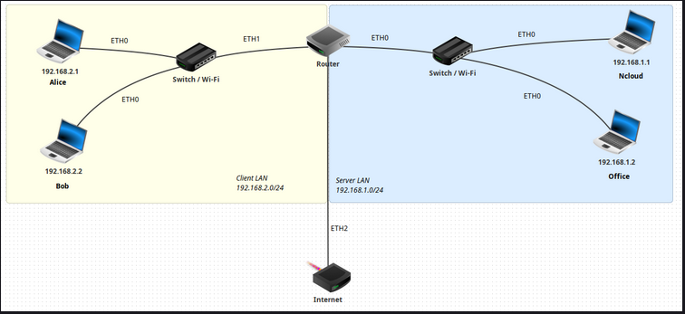

- **LAN Server** ('192.168.1.0/24'): contains 'ncloud', 'office', and 'router' (via eth0)
- **LAN Client** (`192.168.2.0/24`): contains 'alice', 'bob', and 'router' (via eth1)
- 'router' serves as the **default gateway** for both subnets and routes traffic between them
- 'router''s 'eth2' interface provides internet access. Its configuration is handled by the environment and must not be modified

### 3.2 IP Addressing Plan

| Machine | Interface | IP Address | Subnet Mask | Default Gateway |
|---------|-----------|------------|-------------|-----------------|
| router | eth0 | 192.168.1.254 | 255.255.255.0 | - |
| router | eth1 | 192.168.2.254 | 255.255.255.0 | - |
| ncloud | eth0 | 192.168.1.1 | 255.255.255.0 | 192.168.1.254 |
| office | eth0 | 192.168.1.2 | 255.255.255.0 | 192.168.1.254 |
| alice | eth0 | 192.168.2.1 | 255.255.255.0 | 192.168.2.254 |
| bob | eth0 | 192.168.2.2 | 255.255.255.0 | 192.168.2.254 |

**What is a /24 subnet?**
A '/24' prefix means the first 24 bits identify the network, leaving 8 bits for hosts. This gives:
- Subnet mask: '255.255.255.0'
- Up to **254 usable host addresses** (`.1` to `.254`)
- Network address: e.g. `192.168.1.0`
- Broadcast address: e.g. `192.168.1.255`

**What is the `lo` (loopback) interface?**
The `lo` interface at address `127.0.0.1` is a virtual interface that allows a machine to communicate with itself without sending any traffic onto the network. It is used for local services and testing without going through the physical network.

---

## 4. Getting Started with NEmu

### Step 1 - Launch the virtual network

From a **regular terminal** on the host machine:

```bash
/mnt/netta/apps/vnet/nemu-vnet ncloud
```

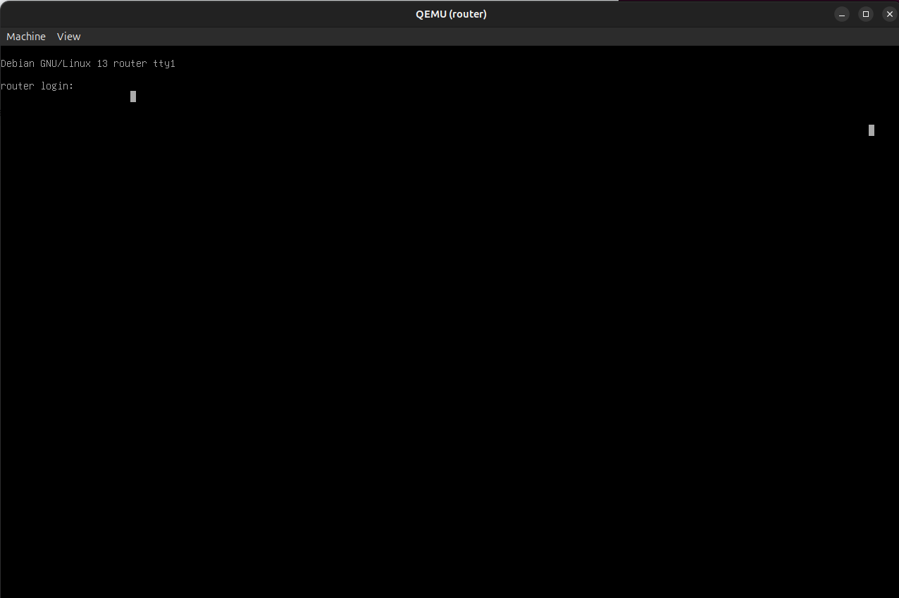

A console window for `router` will appear. This is the only VM started by default.

### Step 2 - Start the remaining VMs

In the **NEmu terminal**, type:

```python
srv() # Starts ncloud and office
```
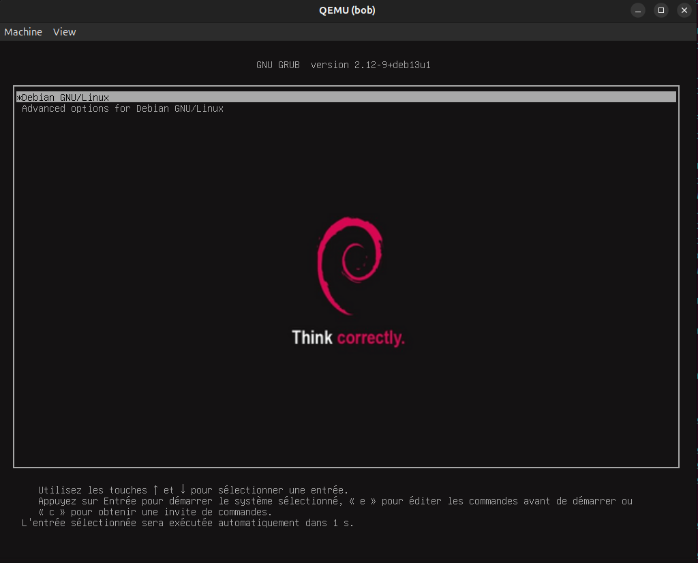

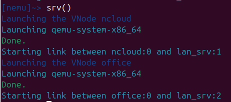

```python
cli() # Starts alice and bob
```
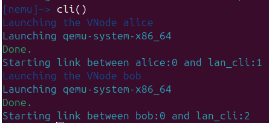

After openning every vm:

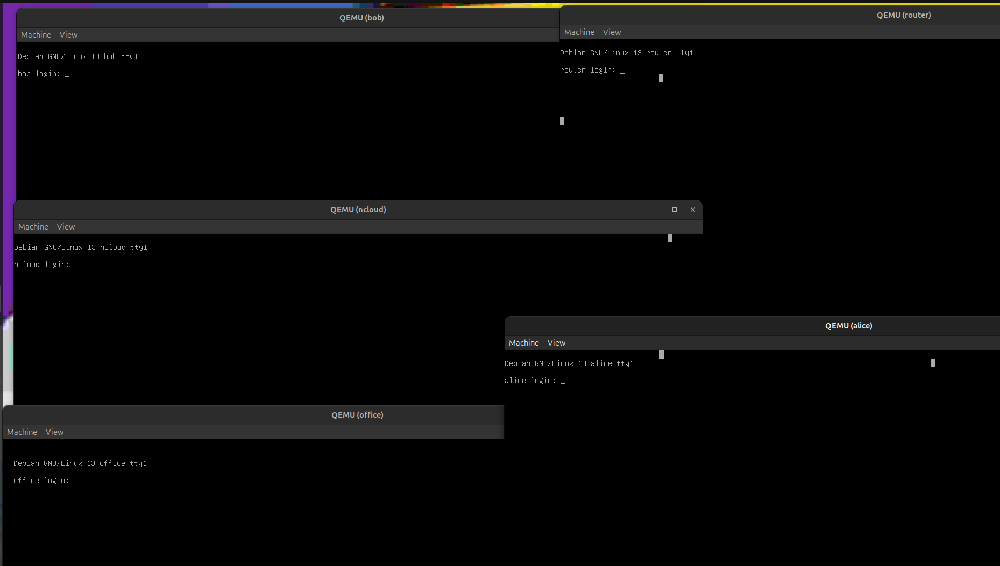

### Step 3 - Navigating VM windows

| Situation | Solution |
|-----------|----------|
| Mouse locked inside VM | Press `Ctrl+Alt+G` |
| Numpad not working | Press `Verr Num` twice |
| Text goes off-screen | Use `Shift+PageUp` / `Shift+PageDown` |
| Need a GUI | Type `startx` in the VM terminal |
| Change screen resolution | Applications -> Settings -> Display |

### Step 4 - Saving and quitting properly

**Always power off all VMs before saving.** Saving with running VMs may corrupt the save.

In **each** VM terminal:

```bash
poweroff
```

Then in the NEmu terminal, once all VMs are off:

```python
save() # Creates ~/vnet/ncloud.tgz
quit() # Exits NEmu
```

### Step 5 - Restoring a previous session

```bash
/mnt/netta/apps/vnet/nemu-restore ~/vnet/ncloud.tgz
```

---

## 5. System and Network Configuration

### 5.1 User Management

> **Machines concerned:** `alice` and `bob`

Log in as `root` on each machine (password: `plop`).

#### Create a standard user

```bash
adduser <your_login>
```

Follow the interactive prompts: enter a password, and optionally fill in the user information fields.

```bash
adduser bob # on bob machine
adduser alice # on alice machine 
```
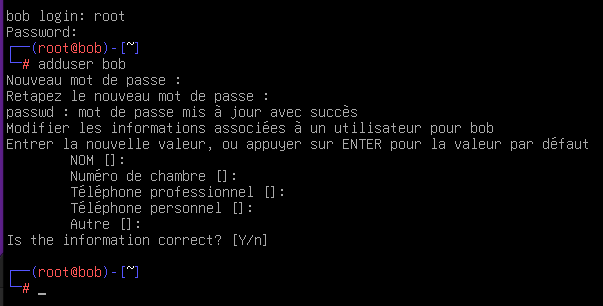

#### Test the new account

```bash
login <your_login> 
```

Verify the login works, then return to root:

```bash
exit
```

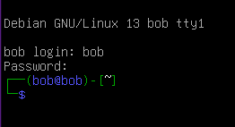

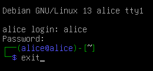

#### Grant sudo privileges

```bash
usermod -aG sudo <your_login>
```

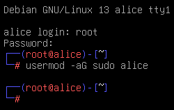

#### Verify group membership

```bash
id <your_login>
```

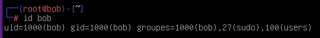

The output should include `(sudo)` in the groups list.

```bash
sudo whoami
```

Expected output: `root`

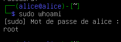

---

### 5.2 Dynamic Network Configuration

> WARNING Commands in this section apply changes **immediately but temporarily**. Configuration is lost on reboot. Permanent configuration is covered later on.

#### View existing interfaces

On every machine, list all network interfaces:

```bash
ifconfig -a
# or, more concisely:
ip -br addr
```

It should look exactly lik this:
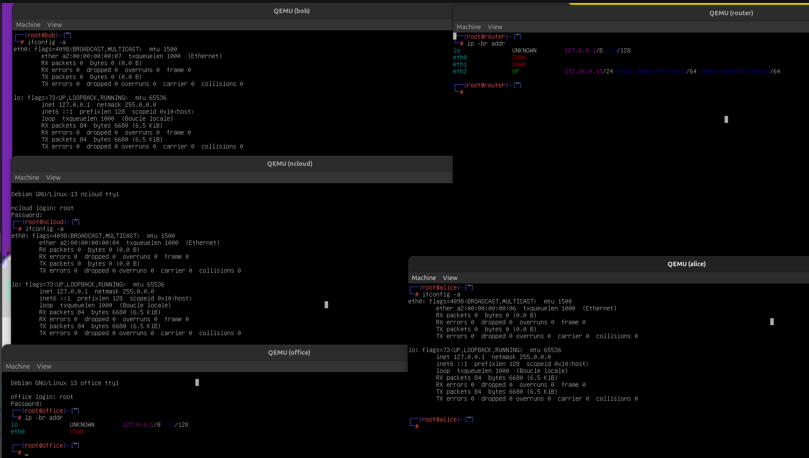

#### Assign IP addresses dynamically

Run the following on each machine:

**On `router`:**
```bash
ifconfig eth0 192.168.1.254 netmask 255.255.255.0 && ifconfig eth0 up
ifconfig eth1 192.168.2.254 netmask 255.255.255.0 && ifconfig eth1 up
```

**On `ncloud`:**
```bash
ifconfig eth0 192.168.1.1 netmask 255.255.255.0 && ifconfig eth0 up
```

**On `office`:**
```bash
ifconfig eth0 192.168.1.2 netmask 255.255.255.0 && ifconfig eth0 up
```

**On `alice`:**
```bash
ifconfig eth0 192.168.2.1 netmask 255.255.255.0 && ifconfig eth0 up
```

**On `bob`:**
```bash
ifconfig eth0 192.168.2.2 netmask 255.255.255.0 && ifconfig eth0 up
```

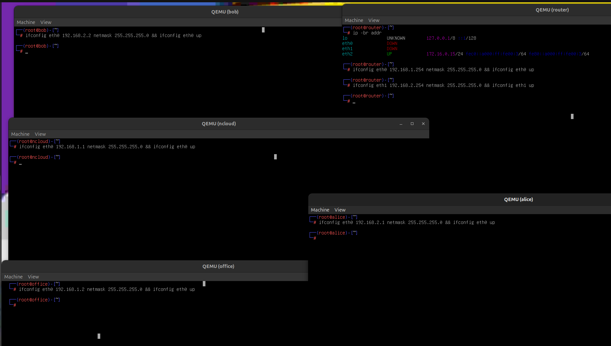

#### Test intra-subnet connectivity

```bash
# From ncloud, ping office:
ping 192.168.1.2
```
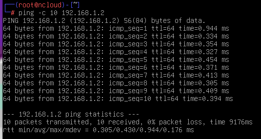

```bash
# From alice, ping bob:
ping -c 3 192.168.2.2
```

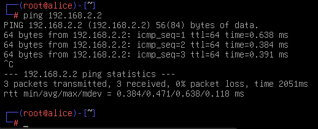

At this point, communication **between** the two subnets is impossible. `router` drops packets not directly addressed to it.

#### Enable IP forwarding on `router`

```bash
echo 1 > /proc/sys/net/ipv4/ip_forward
```

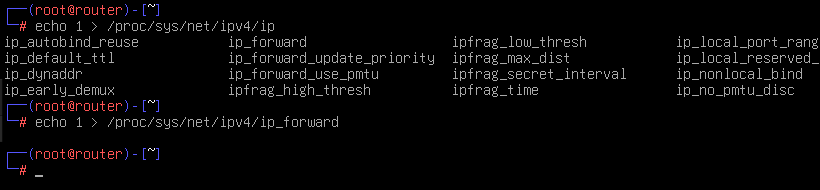

**Why is inter-subnet communication still not working?**
Even with forwarding enabled, `ncloud` and `alice` do not know how to reach each other's subnets. They need a **default gateway** pointing to `router`.

#### Configure the default gateway

On `ncloud` and `office` (LAN Server):
```bash
route add default gw 192.168.1.254
```

On `alice` and `bob` (LAN Client):
```bash
route add default gw 192.168.2.254
```

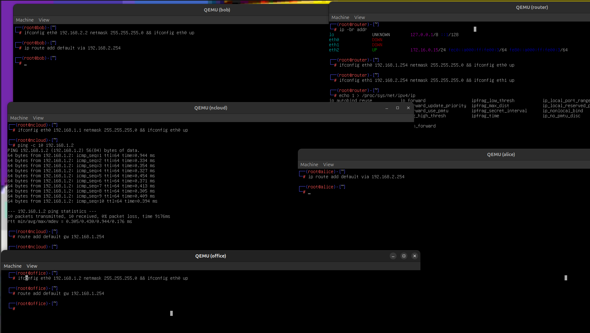

#### Test inter-subnet connectivity

```bash
# From alice, ping ncloud across subnets:
ping 192.168.1.1
```
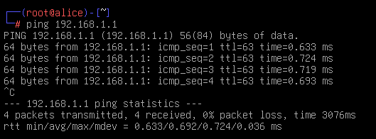

To be able to connect using to SSH there are some more step to follow. On every machine run (or only the one you are using ssh on)

```bash
apt update # We may aswell update
apt install ssh
```
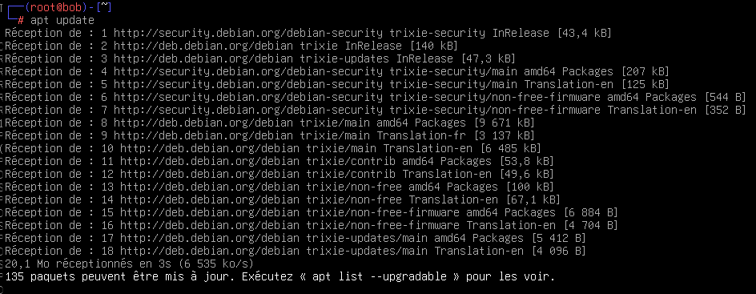

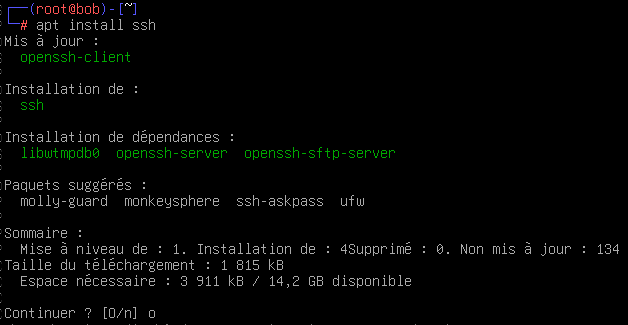

We also need to allow root login via SSH. To do so, we modify the following line in /etc/ssh/ssh_config from #PermitRootLogin prohibitPassword to PermitRootLogin yes.

```bash
nano /etc/ssh/ssh_config
```
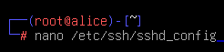

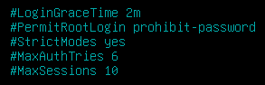

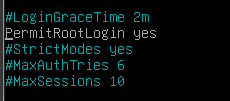

Now SSH works you can try it:
```bash
# SSH from alice to ncloud:
ssh root@192.168.1.1
```
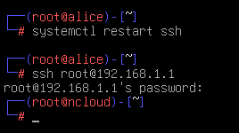

```bash
# Exit the SSH connection
exit
```

#### Trace the packet path

You can now use traceroute to show the route IP packets take : 
```bash
# From alice to ncloud:
traceroute 192.168.1.1
```

Expected output: `alice (192.168.2.1)` -> `router eth1 (192.168.2.254)` -> `ncloud (192.168.1.1)`

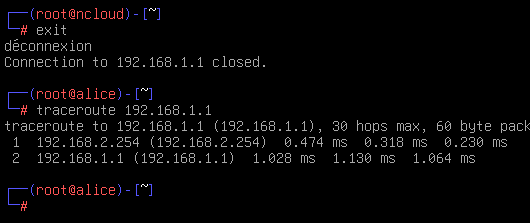

#### Reboot and observe

Reboot all machines:

```bash
reboot
```

After restart, check the configuration:

```bash
ip -br addr
route -n
```

**Observation:** All IP addresses and routing rules have been lost. Dynamic configuration is volatile and does not survive reboots. We need static configuration.

---

### 5.3 Static Network Configuration

Edit the file `/etc/network/interfaces` on each machine. Use `nano`, `micro`, or `vim` to edit (we used `nano`).

```bash
nano /etc/network/interfaces
```

IMPORTANT Do **not** modify lines already present in the file. Only **add** new configuration blocks at the end.

#### `alice` - `/etc/network/interfaces`

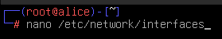

```
auto eth0
iface eth0 inet static
  address 192.168.2.1
  netmask 255.255.255.0
  gateway 192.168.2.254
```

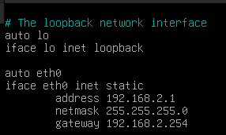

#### `ncloud` - `/etc/network/interfaces`

```
auto eth0
iface eth0 inet static
  address 192.168.1.1
  netmask 255.255.255.0
  gateway 192.168.1.254
```

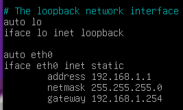

#### `office` - `/etc/network/interfaces`

```
auto eth0
iface eth0 inet static
  address 192.168.1.2
  netmask 255.255.255.0
  gateway 192.168.1.254
```

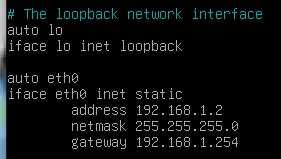

#### `bob` - `/etc/network/interfaces`

```
auto eth0
iface eth0 inet static
  address 192.168.2.2
  netmask 255.255.255.0
  gateway 192.168.2.254
```

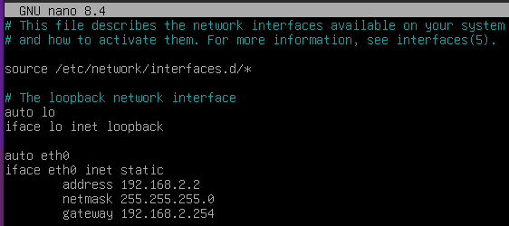

#### `router` - `/etc/network/interfaces`

`router` has **no `gateway`** line. It already knows all subnets directly. IP forwarding is enabled via the `up` directive.

```
auto eth0
iface eth0 inet static
  address 192.168.1.254
  netmask 255.255.255.0
  up echo 1 > /proc/sys/net/ipv4/ip_forward

auto eth1
iface eth1 inet static
  address 192.168.2.254
  netmask 255.255.255.0
```

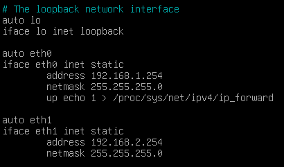

#### Apply the configuration

On **each** machine after editing the file:

```bash
systemctl restart networking
```

If something goes wrong:

```bash
systemctl status networking
journalctl --reverse --unit networking
```

#### Verify persistence

Reboot each machine:

```bash
reboot
```

After restart, verify that configuration was preserved:

```bash
ip -br addr      # IP addresses should be present
route -n         # Default gateway should appear
ping 192.168.1.1 # Cross-subnet ping should still work
```
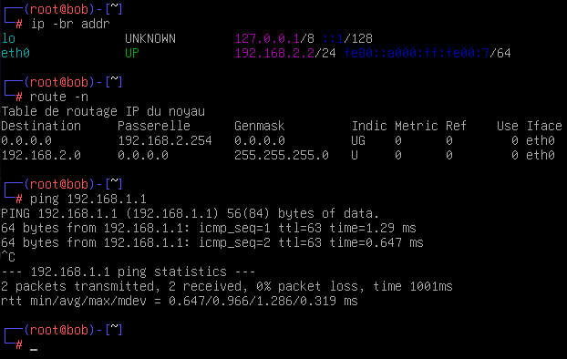

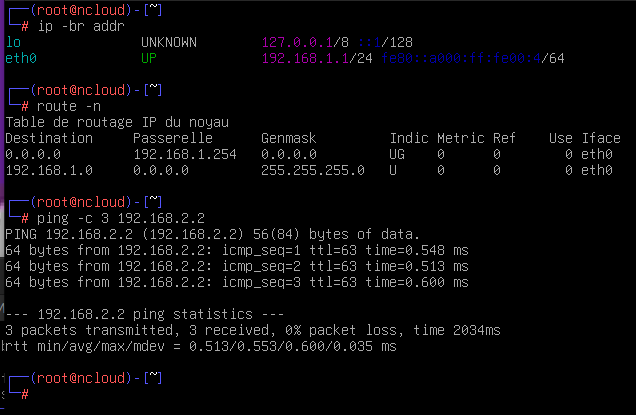
---

## 6. Server Installation and Configuration

### 6.1 Nextcloud Installation

> **Machine:** `ncloud`

#### About package managers

Before installing, here is a comparison of package managers across operating systems:

| OS | Package Manager | Package Format |
|----|----------------|----------------|
| Debian / Ubuntu / Mint / Raspbian | `apt` | `.deb` |
| Fedora / Red Hat / CentOS | `dnf` (formerly `yum`) | `.rpm` |
| OpenSUSE | `zypper` | `.rpm` |
| Arch Linux (best distro) | `pacman` | `.pkg.tar.zst` |
| Windows | `winget`, `chocolatey`, `scoop` | `.msi`, `.exe` |
| macOS | `homebrew`, `MacPorts` | formulae / `.dmg` |

#### Install the Snap daemon

```bash
apt install snapd
```

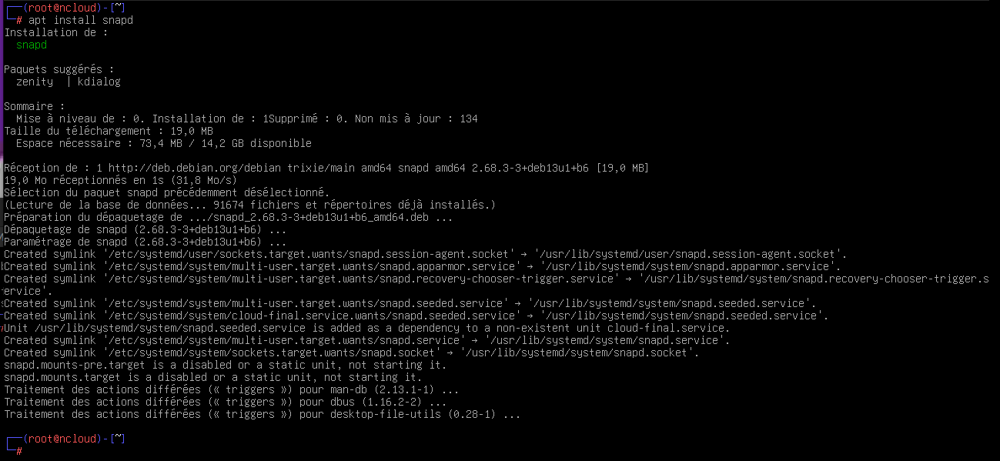

#### Install Nextcloud via Snap

```bash
snap install nextcloud
```

This may take several minutes. Snap downloads the Nextcloud package along with all bundled dependencies.

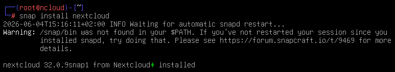

#### Access the Nextcloud web interface

Start the graphical environment:

```bash
startx
```

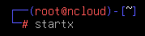

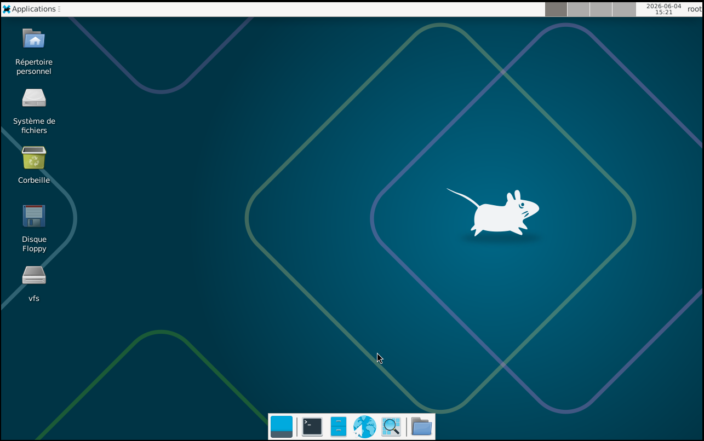

Open a web browser using the icon


and navigate to:

```
http://192.168.1.1
```

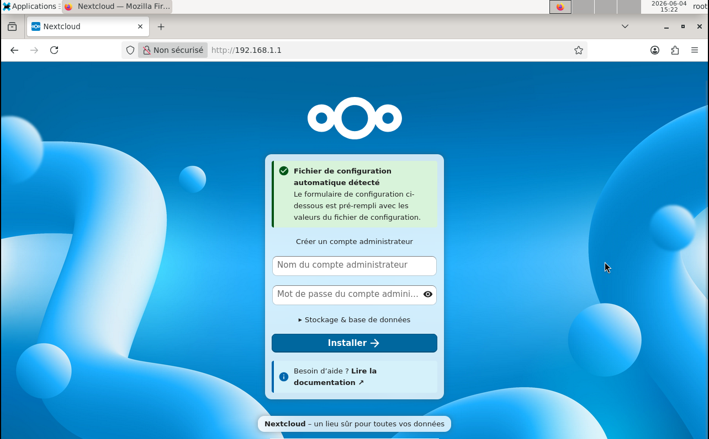

> If you accidentally connected via `127.0.0.1`, run the following and reconnect:
> ```bash
> snap set nextcloud listen.http=192.168.1.1
> snap run nextcloud.occ config:system:set trusted_domains 1 --value=192.168.1.1
> snap restart nextcloud
> ```

#### Create the administrator account

On the **first-run setup page**:
- Choose a username and a strong password for the **admin** account (don't follow our exemple) and click install

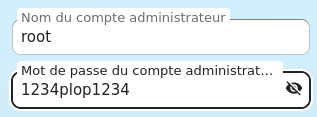


- When prompted to install recommended applications, click **Skip** (to keep the installation minimal for us it was Ignorer)


Congrats you are in !

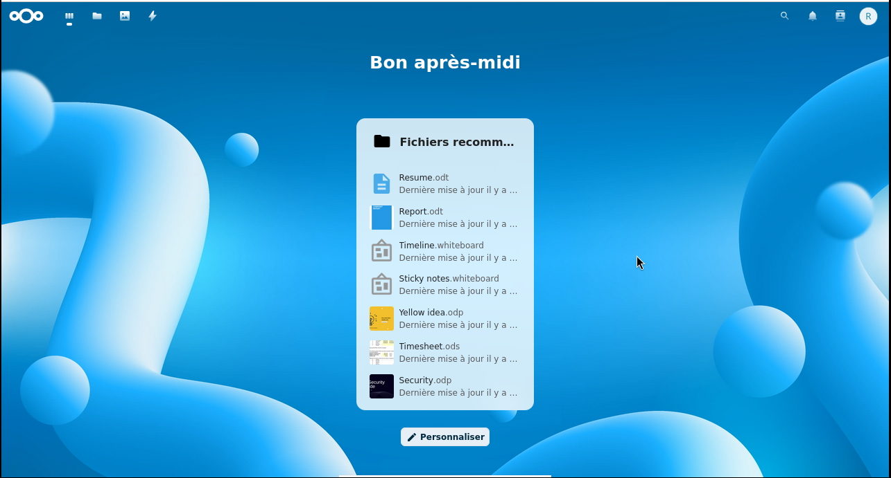
---

### 6.2 Nextcloud Security Configuration

Navigate to **Administration Settings -> Overview** to review the security warnings. We will address only the most critical ones (red and orange indicators).

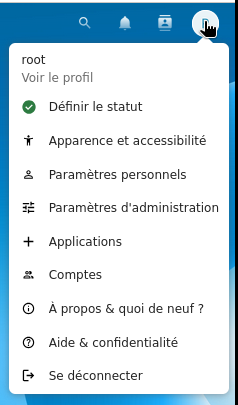

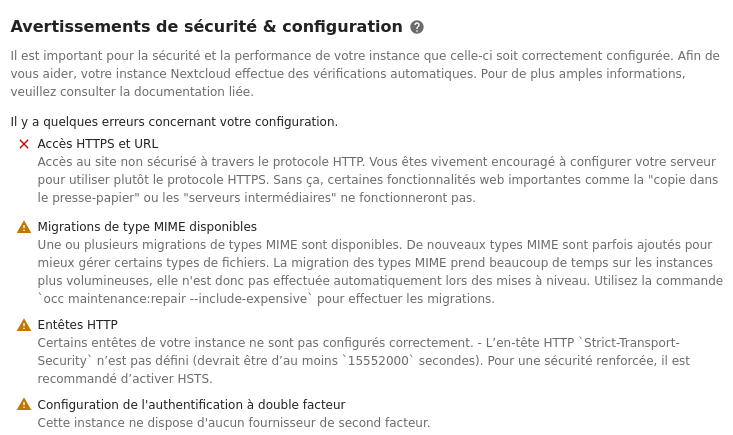

#### Fix: MIME types

```bash
snap run nextcloud.occ maintenance:repair --include-expensive
```

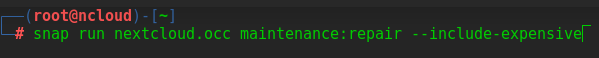

**What are MIME types?**
MIME types (Multipurpose Internet Mail Extensions) are standardised identifiers that indicate the nature and format of a file or data stream (e.g. `text/html`, `image/png`, `application/pdf`). Web browsers and servers use them to determine how to process and display content.

#### Switch from HTTP to HTTPS

Two critical warnings concern the lack of encryption. We need to switch from HTTP to HTTPS to protect data in transit.

| Concept | Explanation |
|---------|-------------|
| **TLS/SSL** | Cryptographic protocols that establish an encrypted channel between client and server, ensuring confidentiality and integrity of data in transit |
| **X.509 certificate** | A digital certificate that binds a public key to an identity (IP address or domain name), signed by a Certificate Authority |
| **Certificate Authority (CA)** | A trusted organisation (e.g. Let's Encrypt, DigiCert) that vouches for the authenticity of a certificate by signing it with its own private key |
| **Self-signed certificate** | A certificate signed by its own private key rather than a CA. Browsers will show a warning because the certificate cannot be independently verified |

**Generate a self-signed TLS certificate on `ncloud`:**

```bash
cd /var/snap/nextcloud/common/
certgen -common-name 192.168.1.1 -host 192.168.1.1
```

**Enable HTTPS:**

```bash
snap run nextcloud.enable-https custom -s public.crt private.key public.crt
```

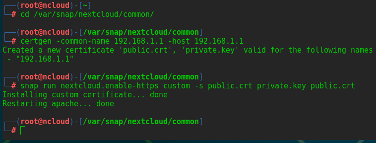

Reconnect at `https://192.168.1.1`. The browser will display a **security warning** because the certificate is self-signed (not issued by a trusted CA). This is expected.

To proceed:
- In Firefox: click **Advanced** -> **Accept the Risk and Continue**

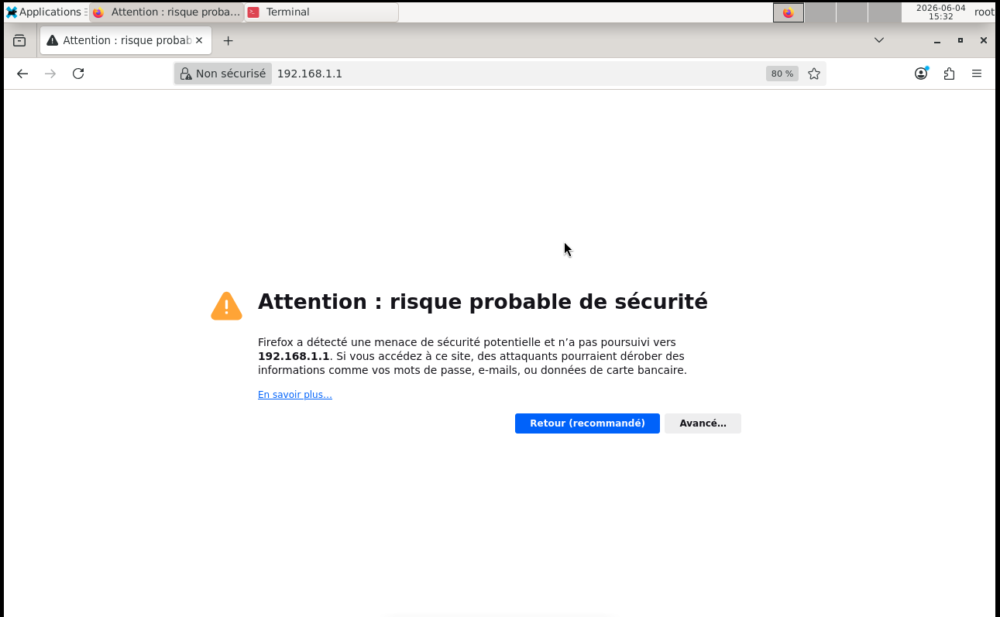


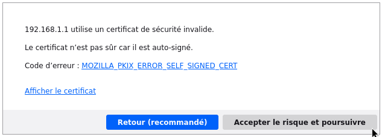


And in firefox settings import the certificate :

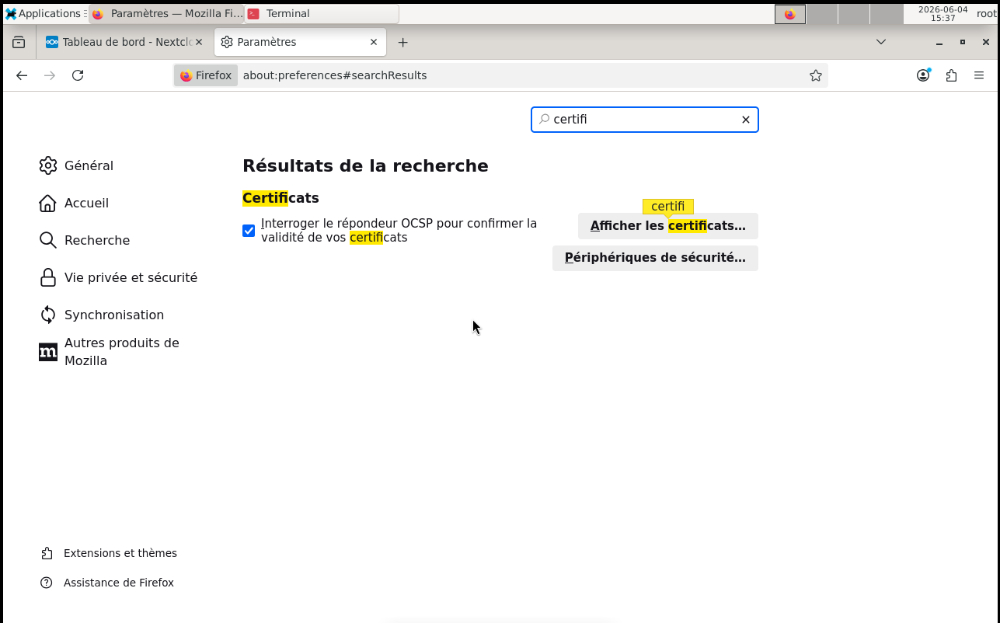


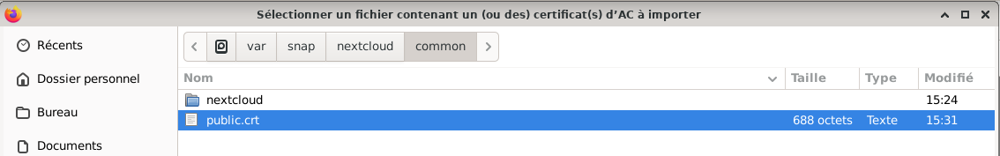

don't forget to check the first checkbox :

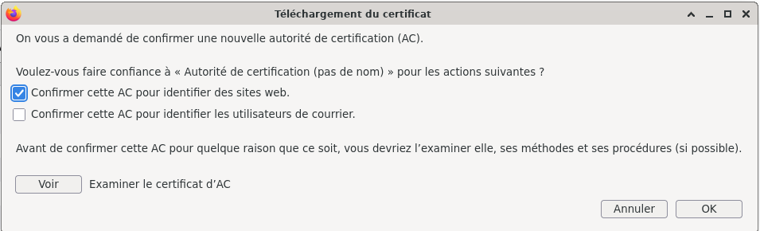

Now we should only have one more issue to address, 2FA - TOTP:


#### Enable Two-Factor Authentication (2FA - TOTP) (and backup codes)

**What is MFA/2FA/TOTP?**

| Term | Meaning |
|------|---------|
| **MFA** (Multi-Factor Authentication) | Requires two or more independent verification factors to authenticate |
| **2FA** (Two-Factor Authentication) | Combines something you *know* (password) with something you *have* (phone) |
| **TOTP** (Time-based One-Time Password) | Generates a 6-digit code that changes every 30 seconds using a shared secret + current time. Standardised in RFC 6238 |

Popular TOTP apps: **Google Authenticator**, **Aegis** (Android, open-source), **Raivo OTP** (iOS), **Authy** (multi-device).

**Steps to enable TOTP on the admin account:**

1. Go to **Administration Settings -> Apps**


2. Search for **Two-Factor TOTP Provider** and click **Enable**


3. Go to **User Settings** (top-right profile menu -> Personal Settings -> Security)


4. Enable **TOTP** and scan the displayed QR code with your TOTP app


5. Enter the 6-digit code shown in your app to confirm activation


6. Congrats now we will **Generate backup codes** to create one-time recovery codes in case you lose your TOTP device

7. Store these codes securely

8. Log out and log back in You should now be prompted for password + TOTP code


You did it ! 


---

### 6.3 Nextcloud General Configuration

#### Public sharing settings

Navigate to **Administration Settings -> Sharing**:


- Set the requirement that **all public links must have a password** ("imposer la protection par mot de passe")


#### Password policy

Navigate to **Administration Settings -> Security**:


Enable the following requirements for user passwords:
- Forbid common passwords
- Mandatory lowercase letters and Uppercase letters
- Mandatory numbers
- Mandatory special characters
- Check password against the **HaveIBeenPwned** database


**What is HaveIBeenPwned?**
HaveIBeenPwned (https://haveibeenpwned.com) is a service that aggregates data from publicly known security breaches. It provides an API that Nextcloud uses to check whether a candidate password has appeared in any known data breach, blocking its use if so. This prevents users from choosing passwords that are already in attackers' dictionaries. (you should check if your email has been pawned)

#### Create a user group

1. Go to **Accounts** -> click the **+** next to Groups


2. Create a new group named **IUT** (or whatever you want)

#### Create user accounts

click the **+ New account**

**User `alice`:**
- Username: `alice`
- Password: (choose one meeting the policy)
- Group: `IUT` with **group admin** rights
- Storage quota: **5 GB**
- Email: *(leave empty)*

**User `bob`:**
- Username: `bob`
- Password: (choose one meeting the policy)
- Group: `IUT`, standard member
- Storage quota: **1 GB**
- Email: *(leave empty)*


#### Personalise user profiles

Log out of the admin account. Log in as `alice`:
- Click the profile icon (top right)
- Update the **Display name** and upload a **profile picture**


Log out, then repeat for `bob`.


#### Create a shared folder (as `alice`)

1. Log in as `alice`
2. In Files, click **+ New** -> Folder -> name it `IUT-Shared`


3. Click the share icon on the folder -> Share with group **IUT** -> set permissions to **Read and Write**


4. Log out and log in as `bob`
5. Verify that the `IUT-Shared` folder is visible and writable


#### Create a password-protected public link (as `alice`)

1. Log in as `alice`
2. Right-click any file -> **Share** -> **Share link**

3. Enable **Password protection** and set a password


4. Copy the generated link


5. Open a **private/incognito** browser window (not logged in to Nextcloud)
6. Paste the link and verify that entering the password gives access to the file


---

### 6.4 OnlyOffice Installation

> **Machine:** `office`

#### Install OnlyOffice

If not done yet on the `office` machine
```bash
apt upgrade
apt install snapd
```

Now install onlyoffice
```bash
snap install onlyoffice-ds
```


#### Retrieve the JWT secret

```bash
snap get onlyoffice-ds onlyoffice.jwt-secret
```


Note this value - we will call it `<secret>`. It will be needed to configure the Nextcloud plugin.

#### Enable remote document editing

```bash
snap set onlyoffice-ds onlyoffice.use-unautorized-storage=true
```


#### Verify the installation

Start the graphical interface (`startx`)
 
and open a browser at:

```
http://192.168.1.2
```

If you see the OnlyOffice welcome/presentation page, the installation is working.


#### Enable HTTPS for OnlyOffice

Generate a self-signed TLS certificate:

```bash
cd /var/snap/onlyoffice-ds/current/var/www/onlyoffice/Data/certs/
certgen -common-name 192.168.1.2 -host 192.168.1.2
ln -s private.key onlyoffice.key
ln -s public.crt onlyoffice.crt
```


Restart the service to apply HTTPS:

```bash
snap restart onlyoffice-ds
```


Connect at `https://192.168.1.2` and add a browser exception for the self-signed certificate (like done for nextcloud).


---

### 6.5 Nextcloud Plugins

> **Account:** Nextcloud **administrator** (`admin`)

#### How to install a plugin

1. Log in to Nextcloud as `admin`
2. Click the profile icon (top right) -> **Apps**


3. Browse best applications or use the search box to find the plugin


4. Click **Download and enable**

---

#### 6.5.1 ONLYOFFICE Plugin

**Purpose:** Connects Nextcloud to the OnlyOffice Document Server, enabling in-browser editing of office documents.

**Install:** Search for **ONLYOFFICE** in Apps and enable it.

**Configure:** Go to **Administration Settings -> ONLYOFFICE** and fill in:


| Setting | Value |
|---------|-------|
| Document Editing Service address | `https://192.168.1.2` |
| Disable certificate verification | yes (self-signed certificate) |
| Secret key | `<your secret from snap get>` |


Click **Save**.

**Enable file formats:** In the same settings page, activate the plugin for:
`doc`, `docx`, `ppt`, `pptx`, `xls`, `xlsx`, `odp`, `ods`, `odt`


**Test:** Log in as `alice` (not as admin) and open a `.docx` file. The OnlyOffice editor should load inside the browser.


---

#### 6.5.2 Splash Plugin

**Purpose:** Displays an automatically changing background image on the Nextcloud login page.

**Install:** Search for **Splash** in Apps and enable it.


**Configure:**
1. Go to **Administration Settings -> Theming**
2. Select **Wallhaven** (or **Bing**) as the image provider
3. Save the settings


**Test:** Log out of Nextcloud. The login page should now display a background image.


---

#### 6.5.3 Passwords Plugin

**Purpose:** A full-featured password manager integrated into Nextcloud, with support for folder organisation and password sharing between users.

**Install:** Search for **Passwords** in Apps and enable it.


**Test:**
1. Log in as `alice` -> open the **Passwords** app
2. Create several password entries (e.g. for a website, for a service)


3. Share one password with `bob`


4. Log in as `bob` -> open Passwords and verify the shared entry appears


---

#### 6.5.4 Secrets Plugin

**Purpose:** Create one-time encrypted secrets accessible via a URL, without requiring a Nextcloud account. The secret is destroyed after being read once.

**Install:** Search for **Secrets** in Apps and enable it.


**Test:**
1. Log in as `alice` -> open the **Secrets** app
2. Write a secret message and generate the URL
3. Copy the URL
4. Open a **private/incognito** browser window (not logged in)
5. Paste the URL - you should be able to read the secret


6. Refresh the page - the secret should now be gone (one-time access)


---

#### 6.5.5 Draw.io Plugin

**Purpose:** Embed a full diagram editor (flowcharts, UML, network diagrams, org charts…) directly in the Nextcloud file browser.

**Install:** Search for **Diagramming** in Apps and enable it.


**Test:**
1. In Files, click **+ New** -> **New diagram**


2. A Draw.io editor will open in the browser
3. Create a simple diagram (e.g. the network topology of this project)

4. Save and verify the file is stored in Nextcloud


---

#### 6.5.6 Calendar Plugin

**Purpose:** A shared group calendar integrated into Nextcloud, compatible with the CalDAV standard.

**Install:** Search for **Calendar** in Apps and enable it.


**Test:**
1. Log in as `admin` and open the **Calendar** app
2. Create a new calendar named **IUT** and share it with the IUT group (read + write)


3. Log in as `alice` -> open Calendar -> create an event in the IUT calendar

4. Log in as `bob` -> open Calendar -> verify alice's event is visible
5. Create a second event as `bob` -> verify it is visible from `alice`'s account


---

#### 6.5.7 FormVox Plugin

**Purpose:** Create and share surveys and forms directly in Nextcloud, with result export.

**Install:** Search for **FormVox** (or **Forms**) in Apps and enable it.

**Test:**
1. Log in as `alice` -> open the **Forms** app
2. Create a form with at least 2 questions (e.g. "What is your name?" and "Which OS do you prefer?")
3. Share the form via a public link (no login required)
4. Open the link in a private/incognito window and submit a test response
5. Return to the form editor -> check the **Results** tab to confirm the response was recorded


---

#### 6.5.8 2 Additional Plugins


**Plugin 1: Notes**

**Purpose:** acts just ike a regular notepad, used for taking notes directly in Nextcloud
**Install:** Go to Apps -> search for Notes -> click Enable
**Test:**
1. Log in as `alice` -> open the **Notes** app
2. Create a note and share it to bob

3. Log in as `bob` -> open Calendar -> verify alice's note is visible


---

**Plugin 2: Talk**

**Purpose:** Instant messaging and chat between Nextcloud users
**Install:** Go to Apps -> search for Talk -> click Enable
**Test:**
1. Log in as `admin` -> open the **talk** app
2. Create a groupchat and share it to the IUT group
3. Log in as `alice` -> open Talk -> verify the groupchat is visible


---

## 7. Client Installation and Configuration

> **Machines:** `alice` and `bob`
> **User accounts:** use the standard user created in section 5.1 (not root)

The Nextcloud Desktop Client provides automatic, bidirectional file synchronisation between the local machine and the Nextcloud server, similar to a Dropbox or Google Drive client.

### Install the desktop client

**Option A - via apt:**

WARNING you must not be root for it to work 


```bash
apt install nextcloud-desktop
```


**Option B - via AppImage (no installation required):**

Download the AppImage from https://nextcloud.com/install/ 


Then:

```bash
chmod +x Nextcloud-*.AppImage
./Nextcloud-*.AppImage
```


### Configure synchronisation

1. Click **Log in to your Nextcloud**
2. Server address: `https://192.168.1.1`

3. Accept the certificate exception (self-signed certificate)

4. Authenticate with the credentials for `alice` (on alice's machine) or `bob` 
(on bob's machine)

5. Choose a local sync folder (e.g. `~/Nextcloud`)

6. Click **Connect**


### Test synchronisation

1. **Web -> local:** Create a new text file in the Nextcloud web interface (as `alice`). Wait a few seconds, then check that it appears in the `~/Nextcloud` folder on `alice`'s machine.

2. **Local -> web:** Create a new file directly in the `~/Nextcloud` folder on `bob`'s machine. Verify that it appears in the Nextcloud web interface and syncs to `alice`.


---

## 8. Portfolio

### Adrian STYZINSKI

As I already boot Linux daily and have already set up some simple self-hosted VPNs, this project helped me consolidate my knowledge in Linux administration as well as static and dynamic network configuration under Debian, including IP addressing, routing, and gateway setup. As a result, I am now more confident in self-hosting my own Google Drive and using these skills in my personal projects.

#### More in depth Adrian STYZINSKI 

**Skills acquired during this project:**
- Static and dynamic network configuration under Debian, including IP addressing, routing, and gateway setup.
- Deployment and basic administration of self-hosted services with Snap.
- Nextcloud installation, initial configuration, HTTPS setup, and security hardening.
- Writing technical documentation in Markdown for a GitLab Wiki.

**Challenges encountered:**
- A challenge was enabling HTTPS for Nextcloud with a self-signed certificate. The browser displayed a security warning because the certificate was not issued by a trusted certificate authority. I understood that this was expected and learned how to add the necessary exception manually.
- Configuring Nextcloud plugins and making them work with OnlyOffice also required careful verification of IP addresses, secrets, and certificate settings.

**Personal reflection:**
- The most interesting part of this project was seeing how a complete professional-like service chain can be built from scratch: network, server, authentication, security, collaboration tools, and client synchronization.
- If I were to redo this project, I would document each step even more precisely while doing it, especially IP choices, configuration files, and error messages, to make troubleshooting faster.
- This project felt realistic because it reproduced tasks commonly found in system administration and network deployment in a professional environment: configuring servers, securing services, and ensuring that multiple users can collaborate reliably.

---

### Simon FOUSAT FERRET

I already had knowledge in self-hosting. I've hosted multiple servers on my own. However, thanks to this project, I now understand how it works better. As I also boot Arch Linux daily, I hope this project will help me debug more easily whenever I encounter any network-related issues.

#### More in depth Simon FOUSAT FERRET 
**Skills acquired during this project:**
- Network troubleshooting with `ping`, `traceroute`, and `ssh`.
- Installation and configuration of OnlyOffice and its integration with Nextcloud.
- Client-side synchronization setup with Nextcloud Desktop on Linux.

**Challenges encountered:**
- A major challenge was understanding why machines in different subnets could not communicate at first. The issue was not only IP addressing, but also packet forwarding on the router and default routes on the clients.
- Another difficulty was connecting Nextcloud and OnlyOffice securely enough for the project to work. We had to configure the OnlyOffice secret, disable certificate verification in the plugin, and verify that the integration worked with document formats supported by the plugin.
- Managing multiple Nextcloud features such as public shares, password policy, TOTP, and plugins required careful testing to avoid breaking an already working configuration.

**Personal reflection:**
- If I were to do this project again, I would separate the work into clearer milestones: first the network, then Nextcloud, then OnlyOffice, then plugins, and finally client synchronization.
- This project is close to real-world IT work because it combines several essential skills: infrastructure setup, service deployment, user management, documentation, and validation through testing.

---
